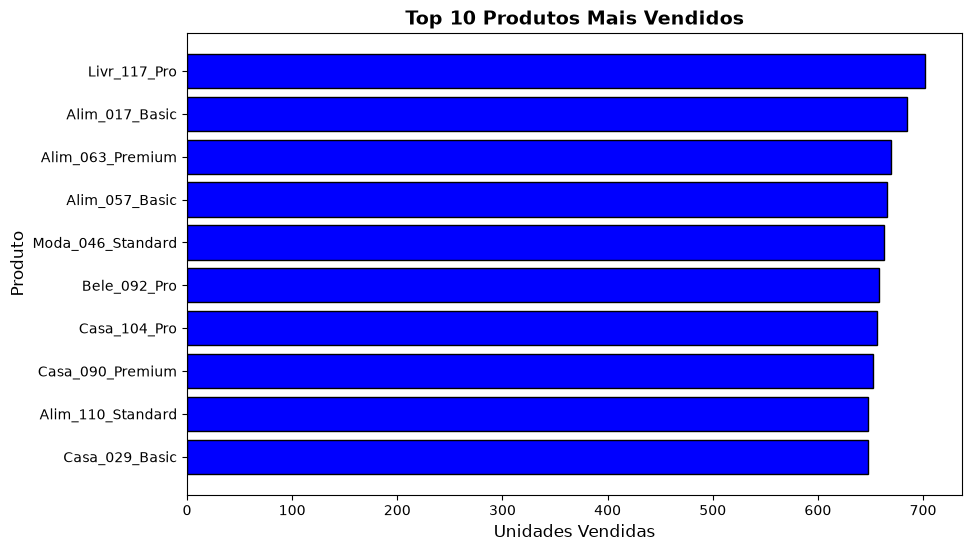
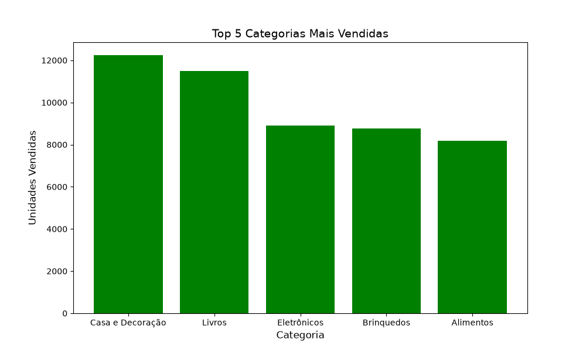
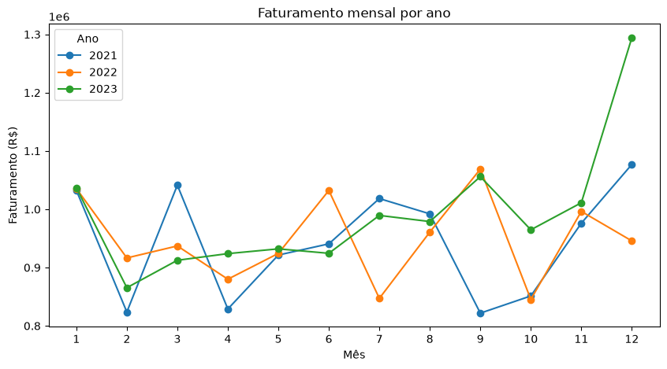
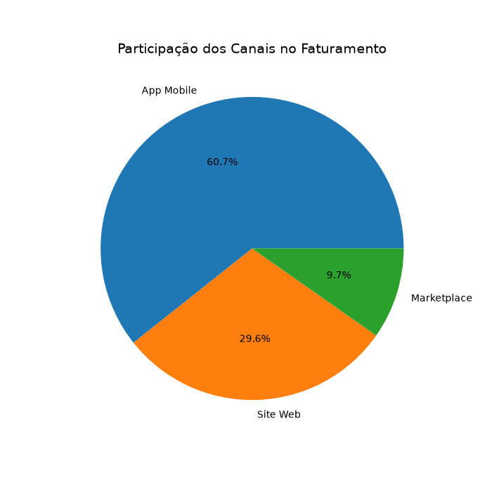
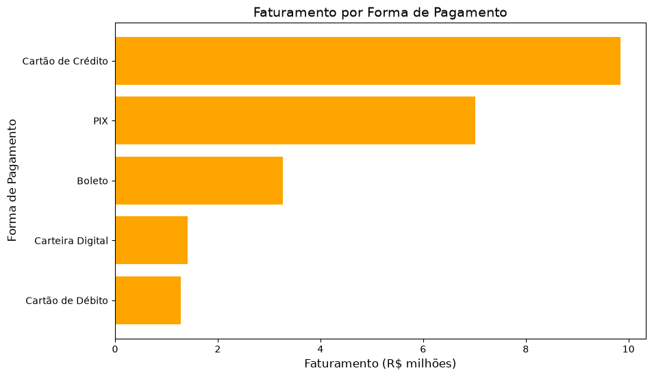
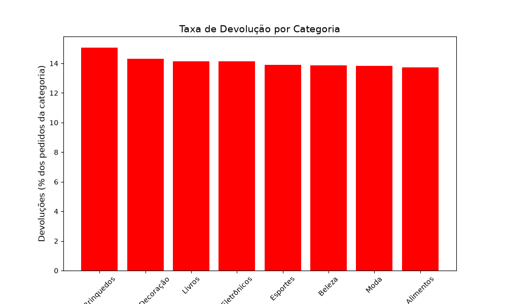
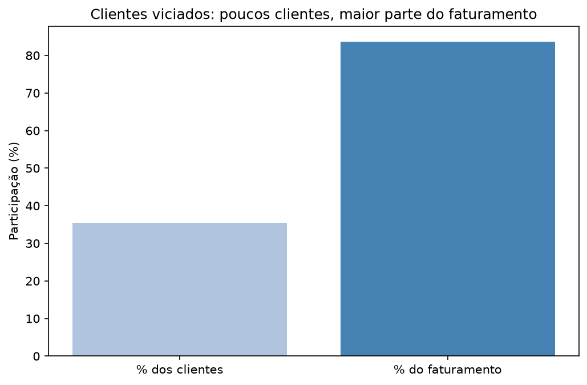

# E-commerce Data Analysis

Projeto de análise de dados voltado para extrair insights de negócio, entender o comportamento do consumidor, avaliar o desempenho de vendas e otimizar a tomada de decisões em uma plataforma de e-commerce.

Autor: Vinícius Rodrigues Rocha

## Tecnologias

- Python
- Pandas
- NumPy
- Matplotlib


## Como executar

1. Instale as bibliotecas: [ pip install pandas numpy matplotlib ]
2. Deixe o arquivo [ clientes.csv ] na mesma pasta do notebook.
3. Abra o notebook no Jupyter e execute as células em ordem.

## Sobre a base de dados

O arquivo [ clientes.csv ] tem 50.000 registros de compras feitas entre 2021 e 2023. O separador é ponto e vírgula e a codificação é UTF-8.

O detalhe mais importante da base: cada linha é um item de um pedido, e não a compra inteira. Um carrinho com três produtos ocupa três linhas com o mesmo [ id_pedido ]. Por isso, sempre que calculei ticket médio ou quantidade de pedidos, agrupei os itens por pedido antes de contar.

## Estrutura do repositório

```
ecommerce-data-analysis/
    dados/clientes.csv
    graficos/graficos.png
    analysis.ipynb
    README.md
```

## Questão 1: Inspeção inicial

Carreguei a base, olhei as primeiras linhas, contei registros e colunas e procurei valores ausentes, duplicados e números estranhos.

São 50.000 registros e 19 colunas:

| Coluna | Tipo                                  |
|---|---------------------------------------|
| id_item, id_pedido, id_cliente | inteiro (int)                         |
| idade_cliente, quantidade | inteiro (int)                         |
| cidade_cliente, estado_cliente | texto (str)                           |
| data_compra | texto (precisa transformar para data) |
| produto, categoria_produto | texto (str)                           |
| preco_unitario, valor_total, valor_frete | decimal (float)                       |
| forma_pagamento, canal_compra, dispositivo_utilizado | texto (str)                           |
| status_pedido, utilizou_cupom | texto (str)                           |
| avaliacao_compra | decimal (float)                       |

Problemas que encontrei logo de cara:

- linhas duplicadas
- nomes de categoria e de forma de pagamento escritos de jeitos diferentes
- quantidades zero ou negativas ex: (-10)
- datas inválidas e data_compra lida como texto
- idades acima de 100 anos
- avaliações fora da escala de 1 a 5
- cidade e estado vazios em algumas linhas

## Questão 2: Tratamento de inconsistências

Fiz a limpeza em uma cópia da base (df_limpo), na ordem abaixo.

| Problema | O que eu fiz                                                                                     |
|---|--------------------------------------------------------------------------------------------------|
| Linhas duplicadas | Removi as linhas totalmente repetidas                                                            |
| "Casa Decoracao", "Eletronicos" | Padronizei para "Casa e Decoração" e "Eletrônicos"                                               |
| "Cartao Credito" | Padronizei para "Cartão de Crédito"                                                              |
| Quantidade zero ou negativa | Removi as linhas, pois não existe comprar -10 unidades                                           |
| Datas inválidas | Converti para data e onde falhou, copiei a data de outro item do mesmo pedido                    |
| Idade acima de 100 | Virou nulo e foi recuperada de outra compra do mesmo cliente                                     |
| Cidade e estado vazios | Copiei de outra compra do mesmo cliente. O que não deu para recuperar ficou como "Não informado" |
| Nota fora de 1 a 5 | Virou nulo, em vez de ajustar para 5, para não distorcer a média                                 |

Os nulos de avaliação que já existiam (pedidos cancelados e em transporte) continuam nulos, porque o cliente ainda não avaliou. Depois da limpeza, a base ficou com **49.768 linhas**.

## Questão 3: Demografia de clientes

A loja atendeu 3.533 clientes distintos. Contei cada cliente uma vez só, usando uma linha por cliente.

| Estado | Clientes |
|---|---|
| RJ | 373 |
| PE | 371 |
| GO | 362 |
| BA | 360 |
| MG | 357 |
| CE | 347 |
| PR | 344 |
| RS | 341 |
| SP | 338 |
| SC | 338 |
| Não informado | 2 |

| Cidades | Clientes |
|---|---|
| Feira de Santana | 135 |
| Aparecida de Goiânia | 129 |
| Fortaleza | 123 |
| Juazeiro do Norte  | 119 |
| Anápolis | 117 |
| Salvador | 116 |
| Goiânia  | 116 |
| Vitória da Conquista | 109 |
| Caucaia | 105 |
| Pelotas | 102 |

As cidades com mais clientes são Feira de Santana (135), Aparecida de Goiânia (129), Fortaleza (123), Juazeiro do Norte (119) e Anápolis (117).

A loja atendeu 3.533 clientes distintos:

Cada um dos 10 estados tem entre 338 e 373 clientes, com RJ (373), PE (371) e GO (362) no topo.

Por cidade, Feira de Santana (135), Aparecida de Goiânia (129) e Fortaleza (123), mas a diferença entre as outras cidades é pequena.

Apenas 2 clientes ficaram sem localização.

## Questão 4: Ticket médio

Usei só pedidos com status "Concluído" e dividi o faturamento pela quantidade de pedidos distintos.

| Indicador | Valor |
|---|---|
| Pedidos concluídos | 14.584 |
| Faturamento total | R$ 22.828.748,60 |
| Ticket médio | R$ 1.565,33 |

Considerando apenas pedidos concluídos e contando pedidos distintos, a loja teve 14.584 pedidos que geraram ( RS 22.828.748,60 ) de faturamento.

O ticket médio é de R$ 1.565,33 por pedido. Esse valor serve de referência para ações como frete grátis ou desconto acima do ticket médio, para estimular carrinhos maiores.

## Questão 5: Curva de produtos

Somei as unidades vendidas, sem contar os pedidos cancelados, porque eles não representam unidades realmente comercializadas.

**Top 10 produtos**

| Posição | Produto | Unidades |
|---|---|---|
| 1 | Livr_117_Pro | 702 |
| 2 | Alim_017_Basic | 685 |
| 3 | Alim_063_Premium | 670 |
| 4 | Alim_057_Basic | 666 |
| 5 | Moda_046_Standard | 663 |
| 6 | Bele_092_Pro | 658 |
| 7 | Casa_104_Pro | 656 |
| 8 | Casa_090_Premium | 652 |
| 9 | Alim_110_Standard | 648 |
| 10 | Casa_029_Basic | 648 |

**Top 5 categorias**

| Categoria | Unidades |
|---|---|
| Casa e Decoração | 12.244 |
| Livros | 11.481 |
| Eletrônicos | 8.902 |
| Brinquedos | 8.775 |
| Alimentos | 8.194 |

Pedidos cancelados foram desconsiderados, pois não representam unidades de contabilização.

Entre os produtos, lideram Livr_117_Pro (702 unidades), Alim_017_Basic (685) e Alim_063_Premium (670), mas a diferença entre o 1º e o 10º é pequena (702 contra 648), o que mostra que nenhum produto teve uma venda absurda.

Entre as categorias, Casa e Decoração vence com 12.244 unidades, seguida de Livros (11.481), Eletrônicos (8.902), Brinquedos (8.775) e Alimentos (8.194).

Casa e Decoração e Livros teve maior volume, com esse valor é um bom numero para comparações.



*Os 10 produtos têm vendas muito parecidas. O líder vende só cerca de 8% a mais que o décimo.*



*Casa e Decoração e Livros vendem bem mais que as outras três categorias.*

## Questão 6: Top clientes (VIPs)

Somei o valor dos pedidos concluídos de cada cliente e peguei os 10 maiores.

| Posição | ID do cliente | Total gasto |
|---|---|---|
| 1 | 72 | R$ 100.413,03 |
| 2 | 202 | R$ 92.522,30 |
| 3 | 897 | R$ 75.130,69 |
| 4 | 980 | R$ 75.033,47 |
| 5 | 442 | R$ 73.107,39 |
| 6 | 725 | R$ 72.750,86 |
| 7 | 602 | R$ 68.999,82 |
| 8 | 447 | R$ 66.933,68 |
| 9 | 782 | R$ 65.965,26 |
| 10 | 875 | R$ 64.820,40 |

Considerando apenas pedidos concluídos, o cliente que mais gastou foi o ID 72 (RS 100.413,03), seguido do ID 202 (RS 92.522,30) e do ID 897 (RS 75.130,69).

Os 10 clientes VIPs somam R$ 755.676,90, cerca de 3,3% do faturamento total, o que mostra que a receita é bem distribuída e não depende de poucos clientes.

## Questão 7: Sazonalidade e evolução

Agrupei o faturamento por ano e mês, sem contar pedidos cancelados.

| Ano | Faturamento |
|---|---|
| 2021 | R$ 11,3 milhões |
| 2022 | R$ 11,3 milhões |
| 2023 | R$ 11,9 milhões |

**Os 5 meses com maior faturamento**

| Mês | Faturamento |
|---|---|
| Dezembro de 2023 | R$ 1.291.314,35 |
| Dezembro de 2021 | R$ 1.075.446,61 |
| Setembro de 2022 | R$ 1.052.386,11 |
| Setembro de 2023 | R$ 1.052.113,33 |
| Janeiro de 2023 | R$ 1.036.025,02 |

Dezembro de 2023 também foi o mês com mais pedidos (719).

O faturamento é estável, com cerca de RS 11,3 milhões em 2021 e 2022 e RS 11,9 milhões em 2023.

Os picos foram dezembro de 2023 (R$ 1,29 milhão e 719 pedidos), dezembro de 2021, setembro de 2022 e 2023 e janeiro de 2023.

Janeiro é o que teve a sazonalidade mantendo os numeros altos, ja fevereiro foi fraco, o que indica sazonalidade moderada ligada as festas de fim de ano.

A loja deve reforçar estoque e campanhas em dezembro e janeiro.



*As três linhas seguem um padrão parecido: janeiro alto, fevereiro baixo e dezembro de 2023 se destacando das demais.*

## Questão 8: Canais e pagamentos

Comparei o faturamento dos pedidos concluídos por forma de pagamento e por canal.

| Forma de pagamento | Faturamento | Participação |
|---|---|---|
| Cartão de Crédito | R$ 9.845.143,95 | 43,1% |
| PIX | R$ 7.021.721,44 | 30,8% |
| Boleto | R$ 3.267.149,23 | 14,3% |
| Carteira Digital | R$ 1.416.139,99 | 6,2% |
| Cartão de Débito | R$ 1.278.593,99 | 5,6% |

| Canal | Faturamento | Participação |
|---|---|---|
| App Mobile | R$ 13.853.785,48 | 60,7% |
| Site Web | R$ 6.751.212,34 | 29,6% |
| Marketplace | R$ 2.223.750,78 | 9,7% |

Considerando pedidos concluídos, o Cartão de Crédito foi o método mais utilizado pelos consumidores, com RS 9,85 milhões, seguido do PIX (RS 7,02 milhões) e do Boleto.

Ja a Carteira Digital e Cartão de Débito com a menor quantidade. Por canal, o App Mobile lidera com RS 13,85 milhões, contra Site Web e Marketplace.

O consumidor prefere comprar pelo celular e pagar com crédito ou PIX, então promoções, cashback e parcelamento devem ser focados nesses meios. (meios mais práticos).



*O app mobile gera 60,7% do faturamento, contra 29,6% do site e 9,7% do marketplace.*



*Cartão de crédito e PIX dominam. Boleto, carteira digital e débito têm peso pequeno.*

## Questão 9: Taxa de insucesso

Contei pedidos distintos (uma linha por pedido) para ver quanto do total foi cancelado ou devolvido.

| Status | Pedidos | Participação |
|---|---|---|
| Concluído | 14.584 | 57,40% |
| Em Transporte | 3.679 | 14,48% |
| Devolvido | 3.594 | 14,15% |
| Cancelado | 3.549 | 13,97% |
| **Total** | **25.406** | 100% |

Taxa de devolução por categoria (devolvidos sobre o total de pedidos da categoria):

| Categoria | Taxa de devolução |
|---|---|
| Brinquedos | 15,06% |
| Casa e Decoração | 14,29% |
| Livros | 14,15% |
| Eletrônicos | 14,14% |
| Esportes | 13,89% |
| Beleza | 13,85% |
| Moda | 13,83% |
| Alimentos | 13,73% |

Dos 25.406 pedidos distintos, 57,40% foram concluídos, 13,97% cancelados, 14,15% devolvidos e 14,48% ainda estão em transporte.

Somando cancelamentos e devoluções, 28,12% dos pedidos não geraram receita, quase 3 em cada 10, o que é uma perda relevante.

Entre as categorias, a taxa de devolução vai de 13,73% (Alimentos) a 15,06% (Brinquedos), perto da média geral de 14,15%.

Como a diferença é pequena, nenhuma categoria se destaca, e o problema parece ser geral da loja e não de um tipo de produto. Sem contar que a base não informa o motivo das devoluções para entender a devolução.



*A taxa fica entre 13,7% e 15,1% em todas as categorias, com Brinquedos no topo.*

## Questão 10: Representação gráfica

Os gráficos ficaram junto de cada análise, com uma legenda curta embaixo de cada um. Resumo de onde estão:

| Gráfico | Tipo | Questão |
|---|---|---|
| Top 10 produtos mais vendidos | barras horizontais | 5 |
| Top 5 categorias mais vendidas | barras | 5 |
| Participação dos canais no faturamento | pizza | 8 |
| Faturamento por forma de pagamento | barras horizontais | 8 |
| Taxa de devolução por categoria | barras | 9 |
| Faturamento mensal por ano | linhas | 7 |

## Questão 11: Estudo Aplicado

O Problema: 

Os clientes que compram várias vezes valem mais para a loja do que os que compram pouco? Se sim, onde focar a fidelização?

Metodologia:

Usei só pedidos concluídos. Primeiro deixei uma linha por pedido (drop_duplicates) e contei quantos pedidos cada cliente fez (value_counts). Depois somei o gasto de cada cliente (groupby) e juntei as duas informações em uma tabela. Chamei de recorrentes os clientes com 4 pedidos ou mais e comparei com os demais em participação nos clientes, participação no faturamento, gasto médio e ticket médio.

Evidências:

Dos 2.757 clientes com pelo menos um pedido concluído, 980 (35,5%) são recorrentes e geram 83,6% do faturamento. Cada um gasta em média RS 19.471, contra RS 2.109 dos demais, cerca de 9 vezes mais. O ticket médio, porém, é praticamente igual (RS 1.566 contra RS 1.560). Ou seja, o cliente recorrente não gasta mais por pedido: ele vale mais porque volta a comprar.



*Os clientes recorrentes são pouco mais de um terço da base, mas concentram mais de 80% do faturamento.*

Recomendação:

A loja deve investir em fazer o cliente comprar de novo. Como o valor do cliente vem da frequência e não do tamanho de cada compra, vale criar ações para quem acabou de fazer o primeiro ou o segundo pedido, como um cupom ou frete grátis na próxima compra, e manter um programa de benefícios para os clientes recorrentes, que sustentam a maior parte da receita. Os dados mostram o padrão, mas não o motivo de o cliente não voltar, então o ideal é testar a ação com um grupo pequeno antes de aplicar em toda a base.
